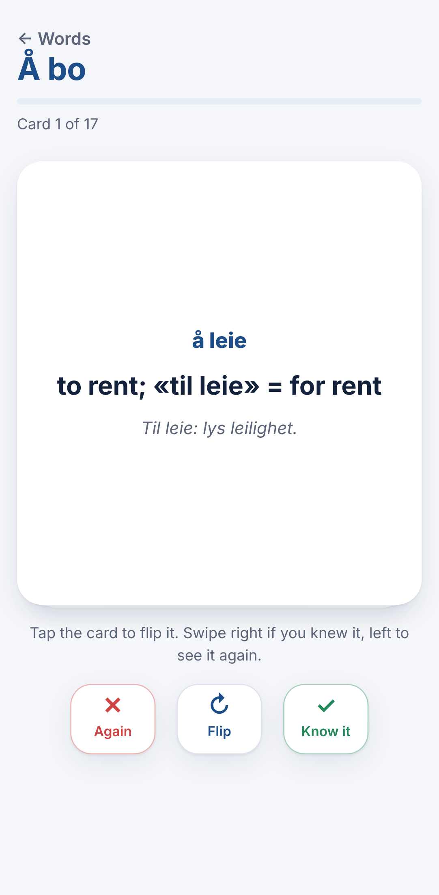

# Tjuvstart

[](https://github.com/ismailsardi/Tjuvstart/actions/workflows/ci.yml)

An installable web app that helps adults moving to Norway learn Norwegian (bokmål) from A1/A2 to CEFR level B2. It estimates your level in each skill as you practise, adapts every exercise to that level, and uses your native language to decide what to teach and how to explain it.

_Tjuvstart_ is Norwegian for a false start: getting going before the starting signal.

> Status: early development. Try it at [ismailsardi.github.io/Tjuvstart](https://ismailsardi.github.io/Tjuvstart/), and see the [product specification](docs/spec.md).

<p>
  
  
  
</p>

## Highlights

- **Adaptive by design:** an Elo-style rating per skill picks each next item at about an 80% expected success rate.
- **Built around CEFR and Norskprøven:** every lesson and task maps to CEFR descriptors, and CI checks coverage.
- **Swipeable word cards:** a card for every word in the lessons, with meanings and memory hooks in the learner's language and SM-2-style spaced repetition.
- **Native-language aware:** cognates, false friends and grammar contrasts for English, French and Arabic speakers.
- **Zero running cost:** a local-first PWA on GitHub Pages; AI features are optional and use the learner's own key.

## Repository layout

```
apps/web/          React + TypeScript PWA (Vite)
packages/engine/   Level rating and item selection, pure TypeScript
content/           Lessons and items as JSON
tools/ContentCli/  .NET 10 content validator, run in CI
docs/              Specification and architecture decision records
```

## Getting started

Requirements: Node.js 22+, pnpm 10, and the .NET 10 SDK for the content tools.

```bash
pnpm install
pnpm dev          # start the web app
pnpm test         # unit tests
pnpm e2e          # Playwright end-to-end tests
pnpm lint && pnpm typecheck

dotnet test tools/ContentCli/ContentCli.slnx
dotnet run --project tools/ContentCli/src/Tjuvstart.ContentCli -- validate content
```

## Documentation

- [Product specification](docs/spec.md)
- [Architecture decision records](docs/adr/)

## License

[MIT](LICENSE)
