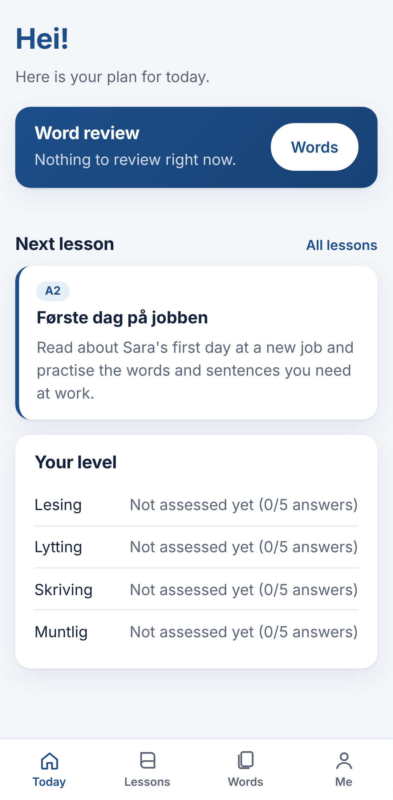
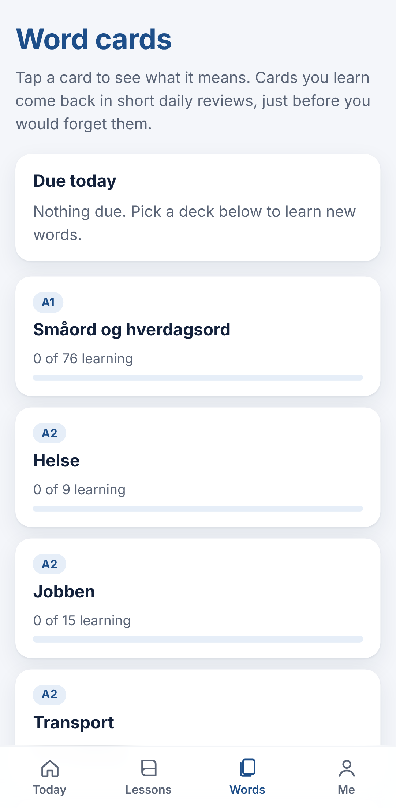

<h1>
  <picture>
    <source media="(prefers-color-scheme: dark)" srcset="docs/brand/logo-dark.svg">
    
  </picture>
</h1>

[](https://github.com/ismailsardi/Tjuvstart/actions/workflows/ci.yml)

An installable web app that helps people moving to Norway learn Norwegian (bokmål), starting from A1/A2, with CEFR level B2 as the goal. It estimates your level in each skill as you practise, adapts every exercise to that level, and uses your native language to decide what to teach and how to explain it.

_Tjuvstart_ is Norwegian for a false start: getting going before the starting signal.

> Status: early development. Try it at [ismailsardi.github.io/Tjuvstart](https://ismailsardi.github.io/Tjuvstart/), and see the [product specification](docs/spec.md).

<p>
  
  
  
</p>

## What works today

- **12 A2 lessons, 155 exercises:** reading, listening, gap-fill, word order and dictation, each tagged with a CEFR level, a difficulty and the grammar points it practises.
- **Adaptive by design:** a five-minute level check, an Elo-style rating per skill, and practice sessions built from the learner's weak skills and recurring mistakes.
- **First weeks in Norway:** a guided track of real situations: the tax card, BankID, renting, the doctor, the first workday and lunch small talk.
- **Real-world texts:** a NAV letter, a Finn.no ad, a job ad and a dugnad notice, simplified to A2 and shown as the documents they are.
- **317 swipeable word cards:** A1 and A2 decks, plus decks for four lines of work, with meanings and memory hooks in the learner's language and SM-2-style spaced repetition.
- **Ten minutes a day:** one daily session of word cards and targeted exercises, a streak that forgives a missed day, and CEFR can-do statements that tick off as the learner proves them.
- **Audio and shadowing:** every sentence and word card is recorded at build time with a neural Norwegian voice (Azure AI Speech free tier, with open-source Piper as fallback); learners listen at an adaptive speed, record themselves and compare.
- **Native-language packs for English and French:** interface, tips, cognates, false friends and grammar contrasts in the learner's language.
- **Optional AI practice:** role-play, writing feedback and fresh reading texts, called straight from the browser with the learner's own Anthropic key and structured outputs.
- **Zero running cost:** a local-first PWA on GitHub Pages. Progress stays in the browser (IndexedDB) and the app works offline.

## Planned

- B1 and B2 lessons, and a licensed frequency list to measure word coverage per level.
- Sign-in and sync across devices through a small ASP.NET Core API on a free tier.
- Speech recognition for speaking practice.
- Calibrated item difficulty (item response theory) and an FSRS scheduler, fitted to the answer and review logs the app already keeps.

## Repository layout

```
apps/web/          React + TypeScript PWA (Vite)
packages/engine/   Level rating and item selection, pure TypeScript
content/           Lessons, word decks, tracks and language packs as JSON
tools/ContentCli/  .NET 10 content validator, run in CI
services/SyncApi/  ASP.NET Core sync API (in progress)
tools/audio/       Build-time audio (Azure neural voice, Piper fallback)
docs/              Specification and architecture decision records
```

## Getting started

Requirements: Node.js 22+, pnpm 10, and the .NET 10 SDK for the content tools and the sync API.

```bash
pnpm install
pnpm dev          # start the web app
pnpm test         # unit tests
pnpm e2e          # Playwright end-to-end tests
pnpm lint && pnpm typecheck

dotnet test tools/ContentCli/ContentCli.slnx
dotnet run --project tools/ContentCli/src/Tjuvstart.ContentCli -- validate content

dotnet test services/SyncApi/SyncApi.slnx
```

Audio is optional for local development: without it, the app uses the browser's Norwegian voice when there is one. To record it locally, see [tools/audio](tools/audio/README.md).

## Documentation

- [Product specification](docs/spec.md)
- [Architecture decision records](docs/adr/)
- [Contributing](CONTRIBUTING.md)

## License

[MIT](LICENSE)
